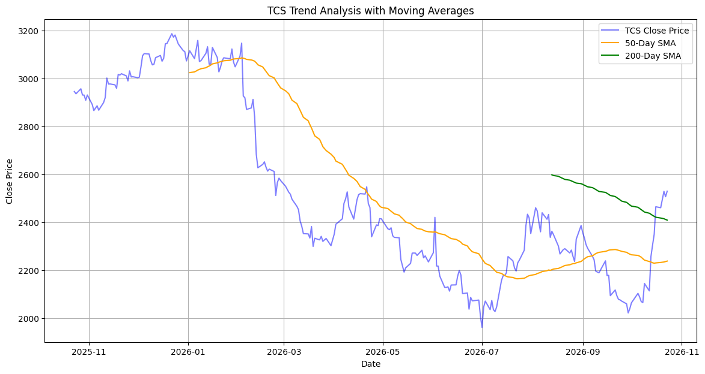
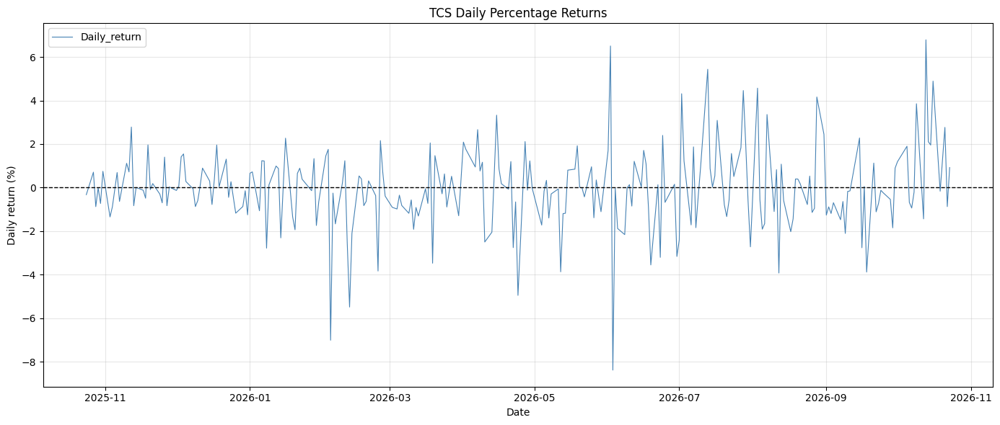
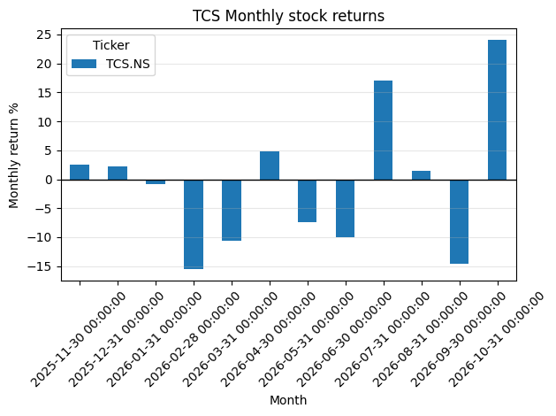
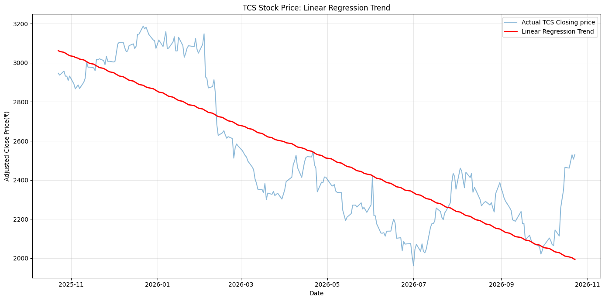

# TCS Stock Trend Analysis

## Project Overview
This project analyzes the historical stock price performance of Tata Consultancy Services (TCS) using Python. It explores price trends, daily and monthly returns, moving averages, and a simple linear regression trend.

## Objectives
- Analyze historical adjusted closing prices of TCS.
- Calculate 50-day and 200-day Simple Moving Averages (SMA).
- Examine daily and monthly stock returns.
- Fit a linear regression model to explore the overall price trend.
- Evaluate the fitted model using R-squared, Mean Absolute Error (MAE), and Root Mean Squared Error (RMSE).

## Tools and Technologies
- Python
- Pandas
- yfinance
- Matplotlib
- NumPy
- Scikit-learn
- Google Colab

## Methodology
1. Retrieved approximately one year of historical TCS stock data using Yahoo Finance data via `yfinance`.
2. Calculated 50-day and 200-day moving averages to examine price trends.
3. Computed daily percentage returns and month-end returns.
4. Used linear regression to fit a simple trend line to historical closing prices.
5. Evaluated the in-sample fit using R-squared, MAE, and RMSE.

## Key Findings
- The adjusted closing price changed from ₹2,946.05 to ₹2,530.00 over the period analyzed.
- The overall adjusted price change was approximately **-14.12%**.
- The linear regression model had an R-squared value of approximately **0.707**.
- The model's in-sample MAE was approximately ₹170.13.
- The model's in-sample RMSE was approximately ₹199.31.

## Limitations
- This analysis uses historical market data and does not predict future stock performance reliably.
- Regression metrics measure the fit to the same data used to train the model; they do not represent out-of-sample forecasting accuracy.
- The latest month in the dataset may be incomplete, so its return should not be compared directly with full-month returns.

## How to Run
Open `TCS_Stock_Trend_Analysis.ipynb` in Google Colab or Jupyter Notebook and run the cells in order. The notebook retrieves data using `yfinance`, so an internet connection is required.

## Disclaimer
This project is for educational purposes only and is not investment advice.

## Visualizations

### 1. TCS Stock Trend Analysis with Moving Averages

### 2. Daily Percentage Returns

### 3. Monthly Stock Returns

### 4. Linear Regression Trend

